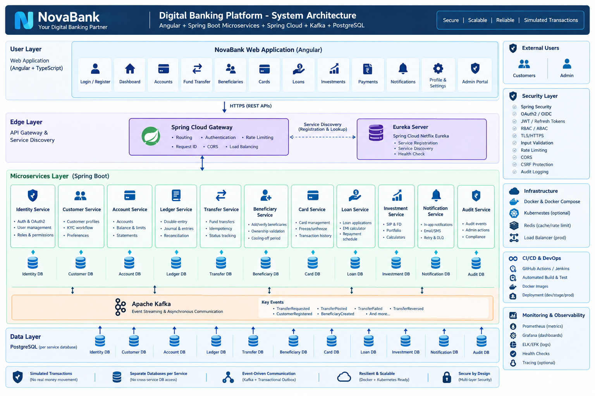

# NovaBank – Digital Banking Platform

Full-stack digital banking web application: **Angular** frontend + **Spring Boot 3 / Spring Cloud** backend, **PostgreSQL**, **Redis**, **Kafka**.

> All payments, transfers, UPI, NEFT/RTGS/IMPS and biller flows are **simulated** until connected to authorized providers. No real money moves.

## Architecture


| Diagram | File |
|---|---|
| Service interaction | [service-diagram.png](docs/architecture/service-diagram.png) |
| ER diagram | [er-diagram.png](docs/architecture/er-diagram.png) |

## Tech stack
- Java 21, Spring Boot 3.5.6, Spring Cloud 2025.0.0 (Gateway, Eureka, OpenFeign, Resilience4j)
- Spring Security, JWT (jjwt 0.12.6) with refresh-token rotation
- Spring Data JPA, PostgreSQL, Flyway
- Redis, Apache Kafka
- springdoc OpenAPI, MapStruct, Lombok
- JUnit 5, Mockito, Testcontainers

## Build
```bash
mvn clean validate
```

## Roadmap
1. Requirements, architecture, ER diagram, design system
2. Auth, registration, profiles, RBAC
3. Dashboard, accounts, transactions, statements, beneficiaries
4. Transfers, ledger, receipts, reconciliation
5. Cards, bills, loans, investments, PFM
6. Admin portal, audit, monitoring, notifications
7. Tests, Docker, CI/CD, deployment docs
